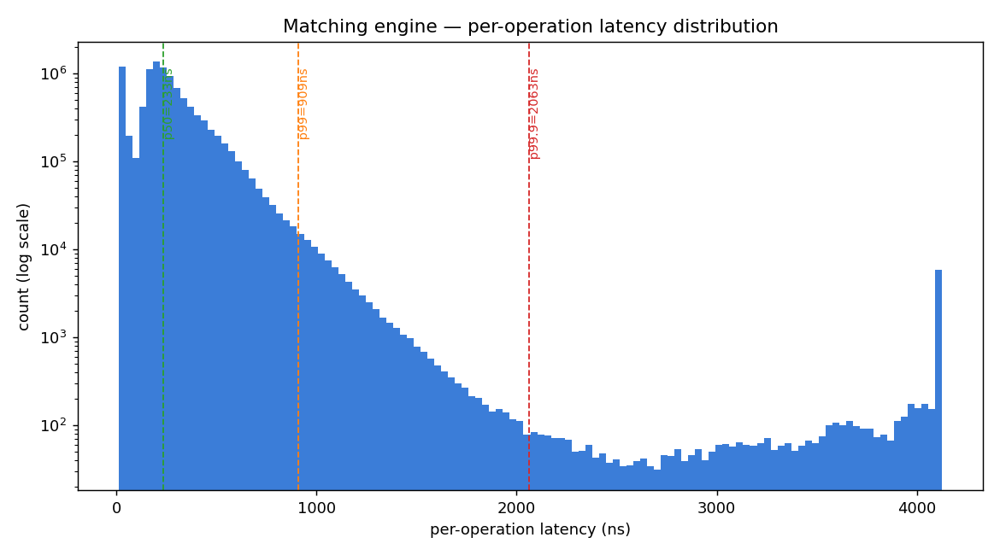

# Benchmark Methodology (`docs/bench.md`)

> Section 9.4 of the build spec: *"This methodology section is what separates a
> serious engineer from someone who pasted a number."* Everything here is
> reproducible — the numbers below are produced by `apps/bench.cpp` on the
> machine named, and will differ on yours. **Re-run it; don't trust the table.**

## 1. Machine

| | |
|---|---|
| CPU | 12th Gen Intel Core **i5-12450H** (8 cores / 12 threads) |
| RAM | 16 GB |
| OS | Windows 11 Home (build 26200) |
| Compiler | MSVC 19.42 (VS 2022), `cl /std:c++17 /O2 /GR- /EHsc /DNDEBUG` |
| Linux build (parity) | `g++ -std=c++17 -O3 -march=native -fno-rtti` |

> Laptop, on AC power, no special isolation/pinning. A server with a fixed
> clock and an isolated core would have a tighter tail. This is deliberately an
> honest "normal laptop" number (Section 0 constraint).

## 2. Workload

- **1,000,000** commands, synthetic (`include/me/synthetic.h`, seed `0xC0FFEE`).
- Mix: ~78% add-limit, ~14% cancel, ~8% market — the CoinTossX-style
  distribution from the spec (Section 3 / 9.1).
- Prices ~ `Normal(mid=10000, sigma=50)` ticks; quantities `Uniform(1,100)`.
- The randomness is in **input generation only** (seeded, reproducible). The
  matching path itself is deterministic (Section 4.5): same seed → identical
  trades and final book (asserted by the determinism unit test).

## 3. How latency is timed

- The cycle counter is `rdtsc` (`include/me/platform.h`), calibrated against
  `std::chrono::steady_clock` over a 50 ms spin to get cycles→ns. Modern CPUs
  have an **invariant TSC** (constant rate regardless of frequency scaling), so
  the conversion factor is stable. Caveat: `rdtsc` is not serialised, so a
  single-op reading has ±a few ns of jitter; over 1M samples this washes out.
- **Only `book.apply(cmd)` is inside the timed region.** Recording the sample,
  computing ns, and everything else happens *after* the second `rdtsc` read.
- Samples are written into a **pre-allocated** array (`LatencyRecorder`); no
  allocation, I/O, or printing happens during the measured loop (Section 9.1).
- **Warm-up:** before measuring, the first 200k commands are replayed on a
  throwaway book to warm the i-cache and branch predictor; those samples are
  discarded. The order-node pool is pre-sized so it never calls `malloc` on the
  hot path.

## 4. Results (this machine — yours will differ)

Two runs: a **10M-order** run (deep book, ~100k resting price levels — this is
the histogram below) and a **1M-order** run (shallower book) for comparison.

**10,000,000 orders:**

```
Throughput: 3.09 M orders/sec  (single-threaded, 10.0 M commands in 3.24 s)
Latency (ns):  p50=233  p90=494  p99=909  p99.9=2063  max=1197926
```

| op | count | p50 | p90 | p99 | p99.9 | max | mean |
|---|---:|---:|---:|---:|---:|---:|---:|
| ALL        | 10,000,000 | 233 | 494 |  909 | 2063 | 1197926 | 278 |
| add-limit  |  7,800,703 | 255 | 494 |  844 | 2899 | 1117236 | 313 |
| add-market |    800,581 | 131 | 380 |  861 | 1607 |  166386 | 190 |
| cancel     |  1,398,716 |  15 | 559 | 1102 | 1593 | 1197926 | 136 |

**1,000,000 orders** (for comparison):

```
Throughput: 3.75 M orders/sec  (1.0 M commands in 0.267 s)
Latency (ns):  p50=197  p90=384  p99=685  p99.9=1519  max=381410
```

Reading the tables:

- **Throughput drops 3.75M → 3.09M and p50 rises 197 → 233 ns from 1M to 10M.**
  That delta is the honest **book-depth effect**: 10M orders build a ~100k-level
  RB-tree, so each `std::map` insert/find chases more (cache-cold) pointers. This
  is exactly the "latency vs book depth" degradation Section 9.3 asks about — and
  the cost the flat-array book (Milestone 3) attacks (`docs/ds_compare.md`).
- **Cancel p50 = 15 ns** — an O(1) `unordered_map` lookup + a few pointer writes,
  the cheapest op regardless of book depth.
- **The `max` (~1 ms at 10M) is not the matching logic** — it's `std::map`
  calling `operator new` for a brand-new price level (plus the occasional page
  fault / scheduler preemption). Order *nodes* use a pre-allocated pool, but
  `std::map` allocates its own RB-tree nodes.

## 5. Reproduce it

```bash
# Linux
make bench
./build/bench --orders 1000000 --csv docs/bench.csv
python3 tools/plot_hist.py docs/bench.csv docs/latency_hist.png
```
```powershell
# Windows
.\build.ps1 bench
.\build\bench.exe --orders 1000000 --csv docs\bench.csv
python tools\plot_hist.py docs\bench.csv docs\latency_hist.png
```

Run-to-run variation on a laptop is ~5–10% on the median and much more on the
`max` (it's a single sample at the mercy of the OS scheduler). Report the
percentiles, not the max, when comparing changes.


